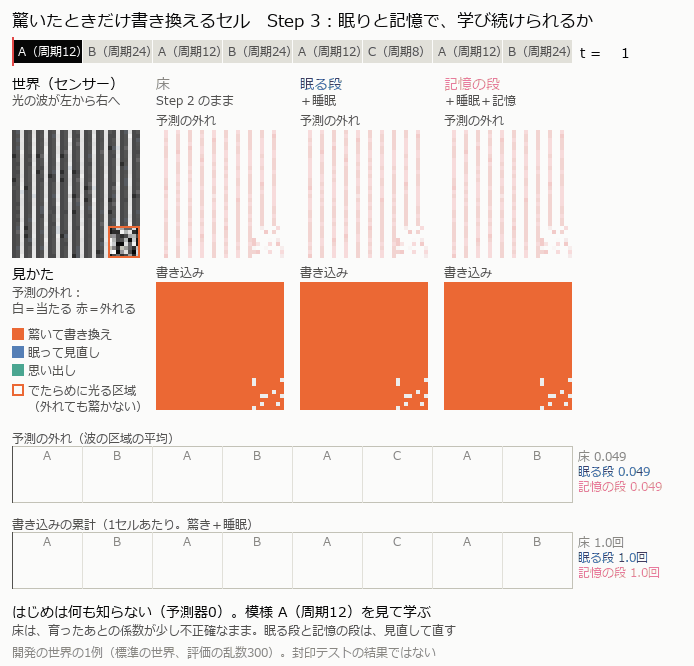

# 濃度発火 NCA

**濃度と予測誤差によって、局所セルが「いつ書き換えるか」を調べる個人研究プロジェクトです。**

ニューラル・セル・オートマトン（NCA）を起点に、形の成長・再生、変化する世界への学び直し、静かな時間の見直し、過去の模様の記憶を段階的に実験しています。

目指しているのは、必要なときにだけ状態を書き換え、使いながら学び続ける小さな仕組みです。現在は **Step 3b：変化を見逃さず、静かな時間の書き込みを減らせるか**を調べています。開発途中の研究であり、言語能力や実機での省電力を実証したものではありません。

*Research prototype exploring concentration-triggered updates, online adaptation, and memory in local cellular systems.*

## まず見るもの

- [Step 1・2のまとめ](SUMMARY.md) — 成果、残った調整、未解決の問い。本文と日付付き追記を併せて読んでください。
- [Step 2の最終まとめ](step2_attention/CLOSING.md) — 注意と学び直しの結果。
- [Step 3の最終まとめ](step3_memory/CLOSING.md) — 記憶と見直しの成果、費用の課題、その後の診断。
- [現在のStep 3bの設計](step3b_quiet/DESIGN.md) — 静かな時間の書き込みを減らすための問いと事前の評価方針。
- [実験ノート](EXPERIMENTS.md)・[変更の台帳](LEDGER.md)・[教訓](LESSONS.md) — 不合格や読み直しを含む記録。

## どこまで進んだか

| 段階 | 問い | 記録上の到達点 |
| --- | --- | --- |
| Step 1：濃度発火 | 育ちきった形を静止させ、傷で再び動かして修復できるか | 花・トカゲの複数シードで確認。形のばらつきや学習中の崩れ、必要な部品の説明が課題として残る |
| Step 2：注意 | 予測の外れを引き金にした更新が、時計・ランダム更新に勝つ条件は何か | 学び直しの条件を満たし、学び始めの条件を満たさずに閉じた。開発で見た条件と、見ていない条件を分けて評価 |
| Step 3：記憶 | 静かな時間の見直しと保存した模様の再利用は役立つか | 事前基準では記憶の主張は合格。見直しの主張は書き込み費用で不合格。取り違えの物差しも診断した |
| Step 3b：静かな時間 | 変化を見逃さず、静かな時間の書き込みを減らせるか | 進行中。公開時点では設計と封印条件の選択記録を含む。成果を確定した段階ではない |

合否は各段階で事前に決めた条件に対するものです。一般的な性能保証ではありません。個々の数値は、リンク先の設計文書・実験記録・各runの `summary.json` を参照してください。

## 動きの説明



同じ波とノイズの世界で、床（Step 2）、見直しを加えた段、さらに記憶を加えた段を比較する説明用の例です。予測の外れと、驚き・見直し・思い出しによる書き込みを表示します。**開発条件の1例であり、合否判定の図ではありません。**

[静止画の一覧](docs/media/step3_explain-sheet.png)もあります。作成元は `step3_memory/explain_gif.py` です。公開に際して既存の画像・GIFをコピーし、再生成や編集はしていません。

## 環境と起動

開発環境は Windows、Python 3.13、PyTorch 2.11.0 + CUDA 12.8、RTX 4060 Ti 8GB です。依存の固定値は元の [requirements.txt](requirements.txt) を保持しています。macOSや別のGPU・CPU構成でのセットアップは未確認です。

PowerShellで、Python 3.13が利用できる場合:

```powershell
git clone https://github.com/jiro-prog/NCA.git
cd NCA
python -m venv .venv
.\.venv\Scripts\python.exe -m pip install -r requirements.txt
```

以後、プロジェクト直下から `.venv` のPythonを使います。元の開発規約・研究方針は [CLAUDE.md](CLAUDE.md) にあります。

### 実装の確認（学習・封印テストを回さない）

```powershell
# 模擬と実装の状態・記録が一致するか。CPUで確認する
.\.venv\Scripts\python.exe step3_memory/check_cell.py --device cpu

# 回帰の確認後、発火・見直し・記憶の会計を確認する
.\.venv\Scripts\python.exe step3_memory/test_accounting.py
```

回帰確認は `step3_memory/runs/check_cell/summary.md` を出力します。既存の実験記録を保持したい場合は、別のcloneで実行してください。公開準備でも独立した検証用コピーを使っています。

### 保存済みのStep 1を評価する

```powershell
.\.venv\Scripts\python.exe step1_concentration/train.py --eval-only step1_concentration/runs/seed0_lam0_tj0.3_db0_tanh
```

保存済み設定と重みを読み、成長・維持・傷・回復を評価してGIFなどを出力します。**評価出力は書き直されるため、記録を保つcloneとは分けて実行してください。** 全実験の再実行とは別の確認です。

### 新たな学習の試運転

```powershell
.\.venv\Scripts\python.exe step1_concentration/train.py --iters 30 --name smoke_public
```

これは短い動作確認です。READMEの成果を再現する学習条件ではありません。代表的なStep 1の条件は、保存されたrunの `config.json` と [SUMMARY.md](SUMMARY.md) を参照してください。

## 比較と計算の数え方

- 同じ条件の時計・ランダム更新などの対照と、予測の質・発火・書き込みを比較します。
- 成功した結果だけでなく、部品を外す検証、不合格、評価方法の修正も記録しています。
- 凍結タグ `baseline-original`、`step2-recipe-frozen`、`step3-recipe-frozen` を保持しています。公開用の文書追加は、凍結した実装の変更を含みません。
- 封印テストは開発用の確認と分け、一度だけ実行する規約です。公開準備では再実行していません。結果は保存済みの記録を参照してください。
- **発火・書き込み回数は実測の速度や消費電力ではありません。** GPUシミュレーションでは、マスクしてもネットワークの計算を全セルに行います。局所・非同期の実機を作った、電力や実行時間を削減した、という主張はしていません。

## ファイルの地図

| パス | 内容 |
| --- | --- |
| `baseline/` | 元祖NCAの最小実装と対照実験 |
| `common/` | 目標画像、評価、乱数、可視化の共通処理 |
| `step1_concentration/` | 濃度発火による成長と修復 |
| `step2_attention/` | 予測・注意・学び直しの実験 |
| `step3_memory/` | 見直し・保存・思い出しと、その評価 |
| `step3b_quiet/` | 現在進行中の設計と条件選択 |
| `*/runs/` | 設定、重み、ログ、集計、図などの実験記録 |
| `tools/` | 順に実験を実行するための補助ツール |

元の研究ファイルとGit履歴を引き継いだ公開版です。変更範囲と照合方法は [PUBLICATION.md](PUBLICATION.md) に記載しています。

## 出典

出発点は Mordvintsev ほかの [Growing Neural Cellular Automata（Distill, 2020）](https://distill.pub/2020/growing-ca/) です。このリポジトリではPyTorchの最小ベースラインから、濃度による更新制御、予測と学び直し、見直しと記憶の実験へ進んでいます。参考研究の一覧は [CLAUDE.md](CLAUDE.md) の「参考になる研究」にあります。

この公開作業では、既存ファイルへのライセンスの付与・変更は行っていません。
